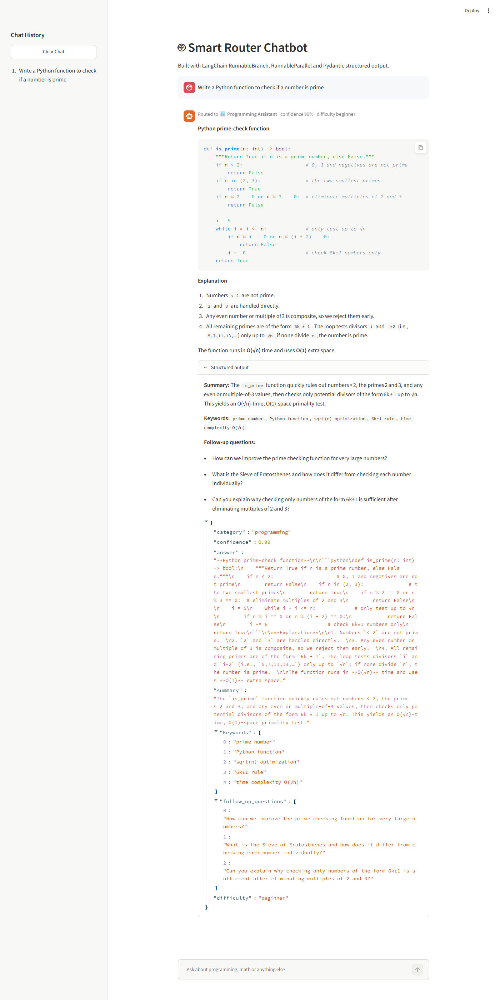
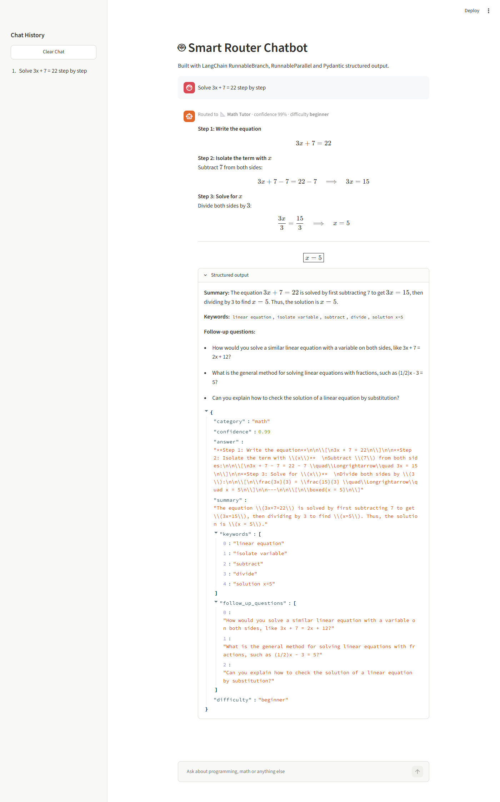
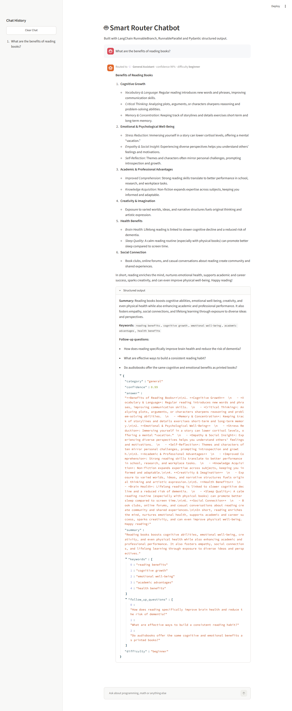

# Smart Router Chatbot (LangChain + Streamlit)

An AI chatbot that **routes** every question to a specialised assistant using `RunnableBranch`, generates **multiple outputs at the same time** using `RunnableParallel`, and returns a **validated Pydantic response** displayed in a Streamlit chat UI.

## Features

- Automatic topic detection: **Programming**, **Math** or **General**
- Specialised prompt pipeline for each topic (Programming Assistant, Math Tutor, General Assistant)
- Parallel generation of **summary** and **insights** (keywords, follow-up questions, difficulty)
- Fully structured, validated response using **Pydantic**
- Context-aware answers (recent chat history is sent to the prompts)
- Streamlit chat interface with chat history, sidebar question list and **Clear Chat** button
- API keys stored securely in `.env`

## Workflow

```
User Question
     │
     ▼
Classifier (PromptTemplate → LLM with structured output → QueryCategory)
     │
     ▼
RunnableBranch
 ├── programming → Programming Assistant prompt
 ├── math        → Math Tutor prompt
 └── default     → General Assistant prompt
     │
     ▼
RunnableParallel
 ├── answer
 ├── summary   (summary prompt → LLM → StrOutputParser)
 └── insights  (insights prompt → LLM with structured output → Insights)
     │
     ▼
ChatResponse (Pydantic BaseModel)
     │
     ▼
Streamlit Chat UI
```

## Project Structure

```
├── app.py            # Streamlit UI
├── chatbot.py        # Model, RunnableBranch, RunnableParallel and full chain
├── prompts.py        # All PromptTemplates
├── schemas.py        # Pydantic schemas
├── requirements.txt
├── .env.example
├── README.md
└── assets/           # Screenshots
```

## Implementation Details

### PromptTemplate

All prompts live in `prompts.py` as `PromptTemplate` objects with dynamic variables (`{question}`, `{chat_history}`, `{answer}`). No prompt text is written inside `invoke()`.

```python
math_prompt = PromptTemplate(
    template="You are a patient Math Tutor ... Question: {question}",
    input_variables=["question", "chat_history"],
)
```

### Pydantic Structured Output

Defined in `schemas.py`:

| Schema | Purpose | Fields |
|---|---|---|
| `QueryCategory` | Classifier output used for routing | `category`, `confidence` |
| `Insights` | Extra information generated in parallel | `keywords`, `follow_up_questions`, `difficulty` |
| `ChatResponse` | Final validated response shown in UI | `category`, `confidence`, `answer`, `summary`, `keywords`, `follow_up_questions`, `difficulty` |

The LLM is forced to follow the schema with `model.with_structured_output(...)`, and the final result is assembled into a `ChatResponse` which validates every field (e.g. `confidence` must be between 0 and 1, `category` must be one of the allowed values).

### RunnableBranch

In `chatbot.py`, the question is first classified, then `RunnableBranch` picks the matching pipeline:

```python
branch_chain = RunnableBranch(
    (is_category("programming"), programming_prompt | model | parser),
    (is_category("math"), math_prompt | model | parser),
    general_prompt | model | parser,  # default branch
)
```

### RunnableParallel

After the answer is generated, `RunnableParallel` runs the summary and insights chains simultaneously:

```python
parallel_chain = RunnableParallel(
    {
        "classification": lambda x: x["classification"],
        "answer": lambda x: x["answer"],
        "summary": summary_prompt | model | parser,
        "insights": insights_prompt | model.with_structured_output(Insights),
    }
)
```

### Full Chain

```python
chain = (
    RunnablePassthrough.assign(classification=classifier_chain)
    | RunnablePassthrough.assign(answer=branch_chain)
    | parallel_chain
    | RunnableLambda(to_chat_response)
)
```

## Installation

1. Clone the repository

   ```bash
   git clone <your-repo-url>
   cd langchain-chatbot-assignment
   ```

2. Create and activate a virtual environment

   ```bash
   python -m venv venv
   venv\Scripts\activate        # Windows
   source venv/bin/activate     # macOS / Linux
   ```

3. Install dependencies

   ```bash
   pip install -r requirements.txt
   ```

4. Create a `.env` file from `.env.example` and add your Groq API key (get one free at https://console.groq.com/keys)

   ```
   GROQ_API_KEY=your_groq_api_key_here
   ```

5. Run the app

   ```bash
   streamlit run app.py
   ```

## Tech Stack

- LangChain (`langchain-core`, `langchain-groq`)
- Groq LLM (`openai/gpt-oss-120b`)
- Pydantic
- Streamlit
- python-dotenv

## Screenshots

### Programming question → Programming Assistant



### Math question → Math Tutor



### General question → General Assistant


